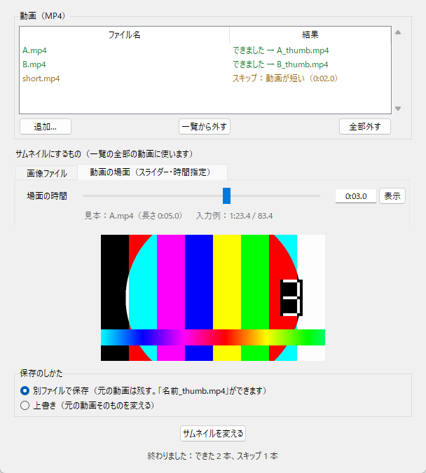

# MP4サムネイル変更

エクスプローラーで見える MP4 のサムネイル（小さな見本の絵）を、好きな画像や、動画の中の好きな場面に変えるアプリです。何本かまとめて処理できます。



## できること
- サムネイルにするものを、タブで選べます
  - **画像ファイル**：JPG・PNG・BMP・WebP の画像をサムネイルにします
  - **動画の場面**：スライダーを動かすか、「1:23.4」「83.4」のように時間を入れて、その場面をサムネイルにします。選んでいる場面は見本で確かめられます
- 保存のしかたを、毎回選べます
  - **別ファイルで保存**：元の動画は残し、「名前_thumb.mp4」を新しく作ります
  - **上書き**：元の動画そのものを変えます（実行の前に確認が出ます）
- 動画は何本でも一覧に入れて、同じ画像、または同じ時間の場面で、まとめて変えられます
- 動画・画像・フォルダは、ボタンで選ぶほか、画面にドラッグ＆ドロップしても入れられます
  - MP4 は一覧へ、画像はサムネイル画像へ、フォルダは中の MP4 を全部一覧へ入れます
- 結果は表で、動画ごとに「できました・スキップ・エラー」と理由を色分けして出します

## 工夫したところ
- **画質が落ちない・すぐ終わる**：動画と音声は作り直さずにそのままコピーし、カバー画像（ファイルに付ける表紙の絵）だけを足します。エクスプローラーは、このカバー画像をサムネイルとして表示します
- **元の動画を壊さない**：まず一時ファイルに書き出し、成功したときだけ置きかえます。途中で失敗しても、元の動画はそのままです
- **入れ替えができる**：すでにカバー画像がある動画では、2枚にならずに入れ替わります
- **スライダーが重くならない**：動かしている間は見本を作らず、手が止まってから作ります。見本は小さく、実際のカバー画像は元の動画と同じ大きさで作ります
- **1本の失敗で止まらない**：選んだ時間より短い動画はスキップ、見つからない動画はエラーにして、残りの動画を続けます
- **作ったファイルをもう一度処理しない**：フォルダを入れたときは、このアプリが作った「_thumb.mp4」を外します
- **画面が固まらない**：処理や見本づくりは別のスレッド（同時に動く別の流れ）で動かします

## 使い方
### 必要なもの
- Python 3（3.13 で確かめました）
- [ffmpeg](https://ffmpeg.org/)（動画や音声を扱う道具。`ffmpeg` と `ffprobe` が使える状態にしておきます）
- tkinterdnd2（ドラッグ＆ドロップ用の部品）

```
pip install -r requirements.txt
```

### 起動

```
python app.py
```

1. 動画を「追加…」で選ぶか、画面にドラッグ＆ドロップします
2. 「画像ファイル」か「動画の場面」のタブを選び、画像か場面を決めます
3. 「別ファイルで保存」か「上書き」を選び、「サムネイルを変える」を押します

### サムネイルの表示が変わらないとき
Windows は一度作ったサムネイルを覚えておくため、すぐに表示が変わらないことがあります。
- F5 キーで表示を新しくするか、表示の大きさ（中アイコン・大アイコンなど）を切りかえてみてください
- それでも変わらないときは、「ディスク クリーンアップ」で「縮小表示」だけにチェックを入れて削除してください（サムネイルの覚え書きが消えるだけで、動画は消えません）

### exe にする（Windows）
[PyInstaller](https://pyinstaller.org/) を使うと、ダブルクリックで開ける exe にできます。exe の中に ffmpeg は入らないので、使うパソコンに ffmpeg が必要です。

```
pip install pyinstaller
python -m PyInstaller --onefile --windowed --name mp4-thumbnail-changer --collect-all tkinterdnd2 app.py
```

`dist` フォルダに `mp4-thumbnail-changer.exe` ができます。

## ファイル
- `app.py`：画面（タブ、スライダー、ドラッグ＆ドロップ、一覧の表、保存のしかた）
- `core.py`：ffmpeg を動かす部分（カバー画像を入れる、場面を取り出す、動画の長さを調べる）
- `requirements.txt`：必要な Python の部品
- `images/screenshot.png`：README の画面写真

## 使ったもの
- Python、tkinter、tkinterdnd2、ffmpeg、PyInstaller
- Claude：1ステップずつ一緒に作り、毎回動かして確かめました
